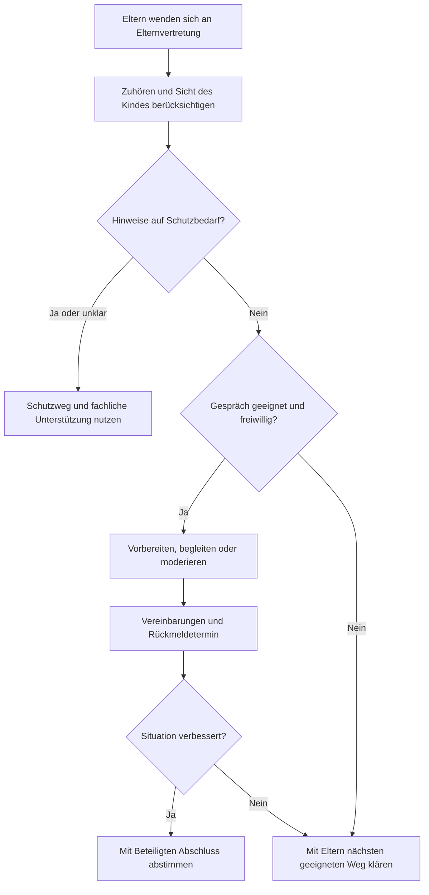

# Stellen- und Aufgabenbeschreibung: Elternvertretung

**Vorschlag – Status:** Überarbeiteter Arbeitsentwurf zur internen Beratung, Stand 07.11.2026. Die vorgelegte Jugendordnung regelt den Elternvertretungs-Beisitz; der ergänzende Aufgabenrahmen zur Konfliktbegleitung ist noch zu beraten. Keine Freigabe zur Veröffentlichung nach außen.

**Fakt – Quelle der Entwurfsgrundlage:** Antworten und Klarstellungen des Auftraggebers im Arbeitsdialog vom 07.11.2026: Gewünscht ist eine gemeinsame Elternvertretung für den Fußball-Jugendbereich. Schwerpunkt ist die Ansprechbarkeit für Eltern in problematischen Situationen, insbesondere wenn ein Kind Probleme mit Trainerteam oder Mitspielenden hat. Die Elternvertretung soll auf Wunsch Gespräche begleiten und bei Bedarf moderieren. Mithilfe bleibt freiwillig. Diese Angaben beschreiben die gewünschte Ausgestaltung.

**Fakt – Arbeitsstand vom 07.11.2026:** Die Fragerunde zur Elternvertretung ist abgeschlossen. Auskünfte zum bestehenden Stand und gewünschte Ausgestaltung sind unten unterschieden. Die verbleibenden Nacharbeiten sind als Folgeaufgaben beziehungsweise bewusst offene Angaben dokumentiert; ein Gremienbeschluss über den ergänzenden Aufgabenrahmen steht aus.

**Fakt – Auskunft zur Besetzung vom 07.11.2026:** Nach Angabe des Auftraggebers wurde die Elternvertretung im März 2025 bei der Jugendvollversammlung gewählt und ist aktuell besetzt. Zur Versammlung wurde laut Auftraggeber ein Protokoll erstellt. Die Jugendordnung bezeichnet das Wahlorgan als Jugendversammlung. **Offene Frage:** Genauen Wahltermin und Fundstelle des Protokolls ergänzen; das Protokoll wurde für diesen Entwurf noch nicht eingesehen.

**Fakt – Dokumentinhalt:** Die [vorgelegte Jugendordnung](../../../grundlagen/originale/bsv-jugendordnung-undatiert.pdf) sieht in § 6 einen Elternvertretungs-Beisitz im Jugendausschuss vor. **Fakt – Auskunft vom 07.11.2026:** Die Fassung ist nach Wissen des Auftraggebers aktuell. **Offene Frage:** Beschluss- und Bestätigungsdatum nachtragen; die [Quellenauswertung](../../../grundlagen/jugendordnung-auswertung.md) dokumentiert Fundstellen und verbleibende Abgrenzungen.

## I Angaben zur Stelle

| Feld | Entwurf / Klärungsbedarf |
| --- | --- |
| Abteilung und Geltungsbereich | **Fakt – gewünschter Umfang:** Gemeinsame Elternvertretung für den gesamten Fußball-Jugendbereich. |
| Stellenbezeichnung | **Vorschlag:** Elternvertretung Jugendfußball. |
| Eingesetzt durch | **Fakt – vorgelegte Jugendordnung, §§ 5–6:** Wahl durch die Jugendversammlung für zwei Jahre; Verbleib im Amt bis zur Neuwahl. Jedes Vereinsmitglied ist in den Jugendausschuss wählbar. **Fakt – Auskunft des Auftraggebers:** Im März 2025 bei der Jugendvollversammlung gewählt und aktuell besetzt; ein Protokoll wurde erstellt. **Offene Frage:** Genauen Wahltermin und Fundstelle des noch nicht eingesehenen Protokolls ergänzen. |
| Organisatorische Anbindung | **Fakt – vorgelegte Jugendordnung, § 6:** Ein Beisitz im Jugendausschuss ist für die Elternvertretung vorgesehen. **Fakt – gewünschte Ausgestaltung laut Arbeitsdialog vom 07.11.2026:** Die Jugendleitung soll die reguläre Ansprechstelle sein; die Elternvertretung vertritt die Elternanliegen eigenständig. Ist die Jugendleitung selbst von einem ungelösten Alltagskonflikt betroffen, soll die Abteilungsleitung Fußball angesprochen werden, sofern sie unbeteiligt ist. Sind Jugendleitung und Abteilungsleitung Fußball selbst betroffen, soll eine externe, neutrale Person die Konfliktklärung übernehmen. |
| Weisungsbefugnis | **Vorschlag:** Vertretungs- und Vermittlungsauftrag; Entscheidungen zu Training, Aufstellungen und Personal verbleiben bei den dafür zuständigen Rollen. |
| Vertretung | **Fakt – Dokumentinhalt:** § 6 nennt einen Elternvertretungs-Beisitz. **Fakt – gewünschte Ausgestaltung laut Arbeitsdialog vom 07.11.2026:** Bei Urlaub, Überlastung oder eigener Beteiligung an einem Konflikt soll je nach Situation gemeinsam mit den betroffenen Eltern eine geeignete Vertretung ausgewählt werden; bei eigener Beteiligung übernimmt eine unbeteiligte Person. Die Übergabe soll durch ein Gespräch mit den nötigen, zur Weitergabe freigegebenen Informationen erfolgen. Die praktische Vertretung begründet keinen zusätzlichen Ausschusssitz. |
| Kontaktwege | **Fakt – gewünschte Ausgestaltung laut Arbeitsdialog vom 07.11.2026:** Die Elternvertretung soll über eine Vereins-E-Mail-Adresse, telefonisch und persönlich erreichbar sein. Eltern sollen über Trainerteams, Saisoninfos, Elternabende und die Vereinswebsite über die Rolle und ihre freigegebenen Kontaktwege informiert werden. Die Elternvertretung soll die Bereitstellung der Kontaktwege und die Information der Eltern koordinieren, abgestimmt mit der Jugendleitung sowie den zuständigen IT- und Kommunikationsfunktionen. **Fakt – Auskunft des Auftraggebers:** Die vorgesehenen Kontaktwege sind bereits nutzbar. **Offene Frage – spätere Ergänzung:** Konkrete freigegebene Kontaktangaben nachtragen. |
| Erste Rückmeldung | **Fakt – gewünschte Ausgestaltung laut Arbeitsdialog vom 07.11.2026:** Bei gewöhnlichen Anliegen soll möglichst innerhalb einer Woche eine erste Rückmeldung erfolgen, etwa als Eingangsbestätigung oder Terminvereinbarung. Dies beschreibt die erste Rückmeldung, keinen Zeitpunkt für eine abschließende Lösung. |
| Einführung und Fortbildung | **Fakt – gewünschte Ausgestaltung laut Arbeitsdialog vom 07.11.2026:** Die Elternvertretung soll eine Einführung in die Rolle und bei Bedarf eine passende Fortbildung zur Gesprächsführung und Deeskalation erhalten. |
| Zeitaufwand | **Fakt – gewünschte Ausgestaltung laut Arbeitsdialog vom 07.11.2026:** Der Aufwand richtet sich nach dem Bedarf, ohne feste Stundenvorgabe. Überlastung soll frühzeitig angesprochen werden. |
| Überprüfung des Aufgabenprofils | **Fakt – gewünschte Ausgestaltung laut Arbeitsdialog vom 07.11.2026:** Das überarbeitete Aufgabenprofil und die Zusammenarbeit sollen bei Bedarf überprüft werden, ohne festen Überprüfungstermin. Elternvertretung und Jugendleitung sollen die Überprüfung gemeinsam vornehmen und allgemeine Rückmeldungen von Eltern und Kindern einbeziehen. |
| Budget und Ausgaben | **Fakt – gewünschte Ausgestaltung laut Arbeitsdialog vom 07.11.2026:** Kein eigenes Budget und keine eigenen Ausgabenbefugnisse. Anfallende Kosten, etwa für Fortbildungen oder externe Konfliktklärung, sollen vorher freigegeben werden. Die Elternvertretung soll die Kostenfreigabe über die Jugendleitung bei der zuständigen Budgetstelle beantragen; die Freigabe richtet sich nach den geltenden Budgetzuständigkeiten. Die Jugendleitung soll je nach Mittelherkunft und geltenden Zuständigkeiten die richtige Budgetstelle klären. |

## II Aufgaben

### Hauptaufgabe

**Vorschlag – gewünschte Wirkung:** Eltern finden frühzeitig eine vertrauenswürdige Ansprechperson, wenn ihr Kind im Vereinsalltag Probleme hat. Kinder werden mit ihrer Sicht ernst genommen. Belastende Situationen werden geklärt, bevor sie sich weiter zuspitzen; die Beteiligten finden tragfähige Vereinbarungen und erhalten Rückmeldungen. Beschwerden können ohne Druck zur Mithilfe und ohne Angst vor Benachteiligung angesprochen werden.

**Fakt – gewünschter Kernauftrag laut Arbeitsdialog:** Eltern in problematischen Situationen ansprechbar unterstützen, Anliegen vertreten und zur Deeskalation beitragen. Auf Wunsch Gespräche begleiten und bei Bedarf moderieren. Mitarbeit und Mithilfe von Eltern bleiben freiwillig.

**Vorschlag – konkrete Aufgaben:**

- Einen leicht zugänglichen Kontakt für Eltern aller Jugendmannschaften ermöglichen. **Fakt – gewünschte Ausgestaltung laut Arbeitsdialog vom 07.11.2026:** Vereins-E-Mail-Adresse, telefonische und persönliche Kontaktaufnahme vorsehen; über Trainerteams, Saisoninfos, Elternabende und die Vereinswebsite über die Rolle und ihre freigegebenen Kontaktwege informieren. Ein vorheriges Gespräch mit dem Trainerteam ist keine Voraussetzung, um sich an die Elternvertretung zu wenden.
- Bei Schwierigkeiten mit Trainerteam oder Mitspielenden zunächst in Ruhe zuhören, das Anliegen ernst nehmen und die gewünschte Unterstützung klären.
- Wahrnehmungen, berichtete Ereignisse, Vermutungen und offene Fragen unterscheiden; keine vorschnelle Schuldzuweisung vornehmen.
- Die Sicht und Wünsche des betroffenen Kindes altersgerecht berücksichtigen und gemeinsam klären, wie es beteiligt werden möchte.
- Mit den Eltern und unter Berücksichtigung des Kindes abstimmen, welche weiteren Personen für die Klärung angesprochen werden dürfen und welche Informationen dafür erforderlich sind.
- Bei geeigneten Alltagskonflikten Gespräche mit Trainerteam oder anderen Eltern vorbereiten, auf Wunsch begleiten und bei Bedarf moderieren; nächste Schritte und einen Rückmeldetermin vereinbaren.
- Nachfragen, ob die Vereinbarungen eingehalten werden und sich die Situation für das Kind verbessert hat; ungelöste Anliegen an die vereinbarte zuständige Stelle geben.
- Wiederkehrende allgemeine Probleme ohne Personenbezug im Jugendausschuss ansprechen und Verbesserungen vorschlagen.

### Vorgeschlagener Klärungsweg für Alltagskonflikte

**Vorschlag – Ablauf:**

1. **Zuhören und Anliegen verstehen:** Was wird berichtet, was belastet das Kind, was wünschen sich Eltern und Kind? Ein ruhiges Einzelgespräch anbieten; Auseinandersetzungen am Spielfeldrand oder in Gruppenchats in einen geeigneten Rahmen verlagern.
2. **Geeigneten Weg klären:** Gibt es Hinweise auf Gefährdung, Gewalt, Übergriffe oder systematische Einschüchterung? Dann den unten beschriebenen Schutzweg nutzen. Eigene Befangenheit, etwa durch Beteiligung des eigenen Kindes, offenlegen und die Begleitung an eine geeignete, unbeteiligte Person übergeben. Die Vertretung je nach Situation gemeinsam mit den betroffenen Eltern auswählen.
3. **Gespräch vorbereiten:** Bei einem geeigneten Alltagskonflikt und Bereitschaft der Beteiligten Ziel, Teilnehmende und Gesprächsrolle vereinbaren. Vorher klären, ob die Elternvertretung die Eltern begleitet oder das Gespräch mit Zustimmung aller moderiert; bei unvereinbaren Rollen eine weitere Person hinzuziehen.
4. **Gespräch deeskalierend führen:** Beteiligte ausreden lassen, konkrete Situationen statt persönlicher Abwertungen besprechen, Auswirkungen auf das Kind benennen und erreichbare Verbesserungen suchen. Bei Druck, Beleidigungen oder Überforderung unterbrechen; keine erzwungene Aussprache.
5. **Konkrete Vereinbarung treffen:** Wer übernimmt welchen nächsten Schritt, bis wann und wann wird gemeinsam nachgefragt? Vereinbarungen nur im geklärten vertraulichen Rahmen festhalten.
6. **Wirkung nachhalten:** Bei Eltern und unter Berücksichtigung des Kindes prüfen, ob sich die Situation verbessert. Wenn Gespräche scheitern oder Vereinbarungen nicht helfen, die Jugendleitung einschalten. **Fakt – gewünschte Ausgestaltung laut Arbeitsdialog vom 07.11.2026:** Ist die Jugendleitung selbst betroffen, soll die Abteilungsleitung Fußball angesprochen werden, sofern sie unbeteiligt ist. Sind Jugendleitung und Abteilungsleitung Fußball selbst betroffen, soll eine externe, neutrale Person die Konfliktklärung übernehmen.

**Fakt – gewünschtes Auswahl- und Beauftragungsverfahren laut Arbeitsdialog vom 07.11.2026:** Elternvertretung und Konfliktbeteiligte sollen sich gemeinsam auf die externe, neutrale Person zur Klärung eines Alltagskonflikts verständigen. Gegebenenfalls anfallende Kosten sollen vorab über die Jugendleitung bei der zuständigen Budgetstelle zur Freigabe beantragt werden. Nach der gegebenenfalls erforderlichen Kostenfreigabe soll ein unbeteiligtes, dafür befugtes Mitglied des geschäftsführenden Vorstands die externe Person formell beauftragen. Die Jugendleitung soll je nach Mittelherkunft und geltenden Zuständigkeiten die richtige Budgetstelle klären.

**Vorschlag – Ablaufübersicht:**

**Vorschlag – Erklärung:** Der Ablauf unterstützt die Klärung von Alltagskonflikten. Ein gemeinsames Gespräch ist freiwillig und kann übersprungen oder beendet werden. Die Elternvertretung begleitet den Weg bis zur Rückmeldung; der Schutzweg ist jederzeit direkt zugänglich.

### Schutzanliegen und Vertraulichkeit

**Vorschlag:** Hinweise auf Gewalt, Übergriffe, ernsthafte Bedrohung oder systematische Einschüchterung nicht als gewöhnlichen Streit behandeln. Für die fachliche Einschätzung die zuständige Schutzperson beziehungsweise eine Fachberatungsstelle hinzuziehen; bei unmittelbarer Gefahr sofort geeignete Hilfe veranlassen. Keine eigenständige Untersuchung und keine gemeinsame Aussprache mit einer beschuldigten Person als ersten Klärungsschritt ansetzen.

**Fakt – gewünschte Ausgestaltung laut Arbeitsdialog vom 07.11.2026:** Wird bei einem Schutzanliegen externe Fachberatung benötigt, sollen die zuständigen Schutz- oder Vertrauenspersonen deren Einbindung koordinieren.

**Vorschlag:** Vertraulichkeit und ihre Grenzen zu Beginn erklären. Persönliche Informationen bei der gewöhnlichen Konfliktbegleitung nur mit ausdrücklicher Freigabe weitergeben. Bei Schutzanliegen kann notwendige Hilfe eine Weitergabe erfordern; das Vorgehen mit fachlicher Unterstützung klären und für die Betroffenen transparent machen. Personenbezogene Fallnotizen gehören in eine dafür freigegebene geschützte Ablage außerhalb dieses Repositorys; Zugriff und Umgang damit gesondert regeln.

**Fakt – Auskunft des Auftraggebers im Arbeitsdialog vom 07.11.2026:** Eine vom Verein freigegebene, geschützte Ablage für notwendige vertrauliche Gesprächsnotizen der Elternvertretung ist noch nicht vorhanden. Sie muss noch eingerichtet oder vereinbart werden.

**Fakt – gewünschte Ausgestaltung laut Arbeitsdialog vom 07.11.2026:** Die Elternvertretung soll die Einrichtung der geschützten Ablage und die Abstimmung ihrer Nutzungsregeln gemeinsam mit der Jugendleitung sowie den zuständigen Datenschutz- und IT-Funktionen organisieren. Auf vertrauliche Notizen zu Alltagskonflikten soll die bearbeitende Elternvertretung Zugriff erhalten; weitere Personen nur bei Bedarf und mit geklärter Berechtigung. Die konkrete Ablage sowie die Aufbewahrungs- und Löschregeln sollen als gesonderte Folgeaufgabe durch dieses Team ausgearbeitet werden; die vorgesehene Aufgabe ist unten dokumentiert.

**Fakt – ergänzende Fachquelle:** Der [dsj-Handlungsleitfaden Safe Sport, Kapitel 3](https://static-dsj-de.s3.amazonaws.com/Publikationen/PDF/SafeSport_Handlungsleitfaden_0626_druck_low.pdf) empfiehlt bei Verdachtsfällen fachliche Unterstützung, sorgfältiges Zuhören und ein mit den Betroffenen abgestimmtes Vorgehen. Er warnt vor suggestiven Befragungen und uneinlösbaren Geheimhaltungszusagen. Diese Fachquelle begründet keine bereits bestehende Zuständigkeit im BSV.

### Mitarbeit und Abgrenzung

**Fakt – Vorgabe für den Entwurf:** Mithilfe bleibt freiwillig.

**Vorschlag:** Die Elternvertretung übernimmt zunächst die Vertretung und Vermittlung. Für die Organisation von Helferdiensten und Veranstaltungen werden eigene Verantwortliche vereinbart. Ein Anliegen darf unabhängig davon eingebracht werden, ob die betreffende Familie im Verein mithilft.

**Vorschlag:** Die Sichtweisen von Kindern und Jugendlichen werden durch deren eigene Beteiligung und Vertretungen eingeholt. Elternvertretung und Jugendvertretung stimmen gemeinsame Themen ab.

## III Zusammenarbeit im Verein

**Vorschlag:**

| Schnittstelle | Gemeinsamer Auftrag und Abgrenzung |
| --- | --- |
| Eltern und betroffene Kinder | In Problemsituationen zuhören, Unterstützungswünsche und Beteiligung des Kindes klären und Rückmeldungen geben. |
| Jugendleitung | **Fakt – gewünschte Ausgestaltung laut Arbeitsdialog vom 07.11.2026:** Reguläre Ansprechstelle bei eigenständiger Vertretung der Elternanliegen. Austausch über allgemeine Anliegen und die Zusammenarbeit nur bei Bedarf, ohne feste Termine; einzelne Konflikte bei Bedarf gesondert besprechen. Bei eigener Beteiligung an einem ungelösten Alltagskonflikt soll die unbeteiligte Abteilungsleitung Fußball angesprochen werden. **Vorschlag:** Unterstützung bei ungelösten Alltagskonflikten und organisatorische Verbesserungen abstimmen. |
| Abteilungsleitung Fußball (AF) | **Fakt – gewünschte Ausgestaltung laut Arbeitsdialog vom 07.11.2026:** Ansprechstelle bei ungelösten Alltagskonflikten, wenn die Jugendleitung selbst betroffen und die Abteilungsleitung Fußball unbeteiligt ist. Sind beide Leitungsrollen selbst betroffen, soll eine externe, neutrale Person die Konfliktklärung übernehmen. |
| Externe, neutrale Person zur Konfliktklärung | **Fakt – gewünschte Ausgestaltung laut Arbeitsdialog vom 07.11.2026:** Elternvertretung und Konfliktbeteiligte sollen sich gemeinsam auf die Person verständigen. Gegebenenfalls anfallende Kosten sollen vorab über die Jugendleitung bei der zuständigen Budgetstelle zur Freigabe beantragt werden. Nach der gegebenenfalls erforderlichen Kostenfreigabe soll ein unbeteiligtes, dafür befugtes Mitglied des geschäftsführenden Vorstands die Person formell beauftragen. Die Jugendleitung soll je nach Mittelherkunft und geltenden Zuständigkeiten die richtige Budgetstelle klären. |
| Trainerteams und Betreuende | Bei geeigneten Konflikten Klärungsgespräche vorbereiten und Vereinbarungen nachhalten; die laufende Mannschaftskommunikation bleibt bei den Teams. |
| Jugendvertretungen und Jugendausschuss | Allgemeine Problemmuster und Verbesserungen beraten; persönliche Fälle nicht ohne Freigabe in die Runde tragen. **Fakt – Dokumentinhalt, § 6:** Die Elternvertretung ist als Beisitz im Jugendausschuss vorgesehen. |
| Mädchenbeauftragte | Gemeinsame Anliegen abstimmen und dabei die eigene Sicht der Mädchen einbeziehen. |
| Zuständige Schutz- und Vertrauenspersonen | **Fakt – Auskunft des Auftraggebers im Arbeitsdialog vom 07.11.2026:** Im Verein sind bereits ausdrücklich Schutz- oder Vertrauenspersonen für Anliegen zum Kinder- und Jugendschutz benannt. Der Elternvertretung sind deren direkte Kontaktwege bekannt. Den zuständigen Schutz- oder Vertrauenspersonen sind passende externe Fachberatungsstellen und deren Kontaktwege bereits bekannt. **Fakt – gewünschte Ausgestaltung laut Arbeitsdialog vom 07.11.2026:** Die zuständigen Schutz- oder Vertrauenspersonen sollen bei Bedarf die Einbindung externer Fachberatung koordinieren. **Vorschlag:** Schutzanliegen über diese Wege behandeln lassen; solche Fälle gehören nicht in die allgemeine Vermittlung oder dieses Repository. |

## IV Rechte

**Fakt – vorgelegte Jugendordnung, §§ 5–6:** Elternvertretungs-Beisitz im Jugendausschuss mit Wahl durch die Jugendversammlung für zwei Jahre; wählbar sind Vereinsmitglieder. Ein eigenständiges Weisungs-, Sanktions- oder Ausgabenrecht der Elternvertretung ist in dieser Fassung nicht beschrieben.

**Fakt – gewünschte Ausgestaltung laut Arbeitsdialog vom 07.11.2026:** Die Elternvertretung soll kein eigenes Budget und keine eigenen Ausgabenbefugnisse erhalten. Anfallende Kosten sollen vorher freigegeben werden. Die Elternvertretung soll die Kostenfreigabe über die Jugendleitung bei der zuständigen Budgetstelle beantragen; die Freigabe selbst richtet sich nach den geltenden Budgetzuständigkeiten.

**Fakt – gewünschte Ausgestaltung zur Außenkommunikation laut Arbeitsdialog vom 07.11.2026:** Die Elternvertretung soll allgemeine Auskünfte zur eigenen Rolle in einem vorher vereinbarten Rahmen geben dürfen. Diesen Rahmen soll sie mit der Jugendleitung und der zuständigen Kommunikationsfunktion vereinbaren; die konkrete Ausarbeitung ist als Folgeaufgabe dokumentiert.

**Vorschlag – nach ausdrücklicher Übertragung:**

- Elternanliegen bei der Jugendleitung beziehungsweise im geeigneten Rahmen des Jugendausschusses einbringen und Rückmeldungen zum Bearbeitungsstand erhalten.
- Die für den Auftrag erforderlichen, freigegebenen organisatorischen Informationen erhalten.
- Auf Wunsch Klärungsgespräche begleiten und mit Zustimmung der Beteiligten moderieren; bei Befangenheit oder Überforderung eine andere geeignete Person hinzuziehen.
- Ungelöste Anliegen an eine vorab vereinbarte weitere Ansprechstelle geben.

**Fakt – gewünschte formale Prüfung laut Arbeitsdialog vom 07.11.2026:** Die Jugendleitung soll gemeinsam mit der Schriftführung und dem geschäftsführenden Vorstand das Aufgabenprofil mit der Vereinssatzung und den formalen Regeln des Jugendausschusses abgleichen, einschließlich seiner Zuständigkeit für die Verabschiedung. Das Prüfergebnis steht aus.

**Fakt – gewünschte Ausgestaltung laut Arbeitsdialog vom 07.11.2026:** Die Jugendleitung soll die konkrete Budgetstelle für Kosten je nach Mittelherkunft und geltenden Zuständigkeiten klären.

### Vorgesehene Folgeaufgaben

**Fakt – gewünschte Ausarbeitung laut Arbeitsdialog vom 07.11.2026:** Die folgenden Aufgaben sollen gesondert durch die vereinbarten Funktionen bearbeitet werden. Die Dokumentation beschreibt die gewünschten nächsten Schritte; ein formaler Auftrag oder Abschluss ist damit nicht nachgewiesen.

| Folgeaufgabe | Vorgesehene Beteiligte | Bearbeitungsstand |
| --- | --- | --- |
| Konkrete geschützte Ablage auswählen und Freigabe, Umsetzung der Zugriffsberechtigungen sowie Aufbewahrungs- und Löschregeln ausarbeiten | Elternvertretung, Jugendleitung sowie zuständige Datenschutz- und IT-Funktionen | **Vorschlag:** Als gesonderte Folgeaufgabe vorgemerkt; Ausarbeitung und Freigabe stehen aus. |
| Aufgabenprofil mit Vereinssatzung und formalen Ausschussregeln abgleichen, einschließlich der Zuständigkeit für die Verabschiedung | Jugendleitung, Schriftführung und geschäftsführender Vorstand | **Vorschlag:** Als Folgeaufgabe vorgemerkt; Prüfergebnis steht aus. |
| Konkreten Rahmen für allgemeine öffentliche Auskünfte zur eigenen Rolle vereinbaren | Elternvertretung, Jugendleitung und zuständige Kommunikationsfunktion | **Vorschlag:** Als Folgeaufgabe vorgemerkt; konkrete Vereinbarung steht aus. |
| Über Rolle und freigegebene Kontaktwege über Trainerteams, Saisoninfos, Elternabende und Vereinswebsite informieren | Koordination durch die Elternvertretung, abgestimmt mit Jugendleitung sowie zuständigen IT- und Kommunikationsfunktionen | **Vorschlag:** Als Folgeaufgabe vorgemerkt; Kontaktwege sind laut Auskunft bereits nutzbar, konkrete Angaben sind später zu ergänzen. Die Freigabe zur Veröffentlichung ist noch einzuholen. |

### Bewusst offene Angaben

**Offene Fragen – Platzhalter und spätere Ergänzungen:**

**Fakt – gewünschter Umgang mit fehlenden Quellenangaben laut Arbeitsdialog vom 07.11.2026:** Die fehlenden Angaben sollen vorerst als sichtbare Platzhalter offenbleiben.

1. **Offene Frage – bewusst zurückgestellt:** Genauer Wahltermin im März 2025: [offen] · Fundstelle des Wahlprotokolls: [offen] · Beschlussdatum der Jugendordnung: [offen] · Bestätigungsdatum der Jugendordnung: [offen].
2. **Offene Frage – spätere Ergänzung:** Vereins-E-Mail-Adresse: [freigegebene Angabe später ergänzen] · Telefonischer Kontakt: [freigegebene Angabe später ergänzen]. **Fakt – Auskunft des Auftraggebers:** Die Kontaktwege sind bereits nutzbar. Die Koordination durch die Elternvertretung in Abstimmung mit Jugendleitung sowie IT- und Kommunikationsfunktionen ist als gewünschte Ausgestaltung geklärt.

**Vorschlag – Zielkonflikt und Alternative:** Nähe zu den Eltern erleichtert den Zugang, kann aber die Gesprächsmoderation erschweren, wenn die Elternvertretung bereits stark in einen Konflikt eingebunden ist. Dann kann sie die Familie weiter begleiten, während eine unbeteiligte geeignete Person moderiert. Unterstützung im Alltag kann die Erreichbarkeit verbessern; der eine Beisitz im Jugendausschuss bleibt davon getrennt.

**Fakt – gewünschter Beratungs- und Verabschiedungsweg laut Arbeitsdialog vom 07.11.2026:** Der ergänzende Aufgabenrahmen der Elternvertretung soll dem Jugendausschuss zur Prüfung und Verabschiedung vorgelegt werden.

**Offene Frage – Beschlussnachweis für den ergänzenden Aufgabenrahmen:** Formale Zuständigkeit des Jugendausschusses anhand der geltenden Vereinsordnungen bestätigen · Datum: [offen] · Quelle / Protokoll: [offen]. Ein Beschluss über diesen Aufgabenrahmen ist noch nicht dokumentiert. Die bestehende Regelung in der vorgelegten Jugendordnung wird durch diesen Entwurf nicht geändert.

## Grundlagen und Bezüge

**Fakt – verwendete Arbeitsgrundlagen:** Arbeitsdialog und Prüfung der vorgelegten Jugendordnung am 07.11.2026; laut Auskunft des Auftraggebers ist die Fassung nach seinem Wissen aktuell. **Offene Frage:** Beschluss- und Bestätigungsdatum sowie Abgleich mit der aktuell geltenden Vereinssatzung.

- [Jugendordnung: Quellenauswertung und Fundstellen](../../../grundlagen/jugendordnung-auswertung.md)
- [Schwerpunkt Interne Kommunikation](../../interne-kommunikation.md)
- [Entwurf Jugendleitung](jugendleitung.md)
- [Entwurf Mädchenbeauftragte](maedchenbeauftragte.md)
- [Kommunikationsformate und Rhythmen](../04-kommunikationsformate-und-rhythmen.md)
