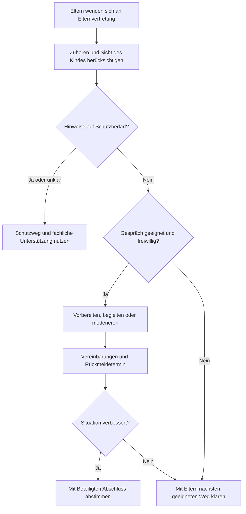

# Stellen- und Aufgabenbeschreibung: Elternvertretung

**Stand:** 07.11.2026

**Fassung:** Inhaltlich abgestimmte Endfassung.

## I Angaben zur Stelle

| Merkmal | Beschreibung |
| --- | --- |
| Bezeichnung | Elternvertretung Jugendfußball |
| Geltungsbereich | Gemeinsame Elternvertretung für den gesamten Fußball-Jugendbereich |
| Wahl und Amtszeit | Wahl durch die Jugendversammlung für zwei Jahre; Verbleib im Amt bis zur Neuwahl. Jedes Vereinsmitglied ist in den Jugendausschuss wählbar. |
| Mitwirkung | Ein Elternvertretungs-Beisitz im Jugendausschuss nach der vorgelegten Jugendordnung |
| Ansprechstelle | Jugendleitung; eigenständige Vertretung der Elternanliegen |
| Erreichbarkeit | Über eine Vereins-E-Mail-Adresse, telefonisch und persönlich |
| Zeitaufwand | Nach Bedarf, ohne feste Stundenvorgabe. Überlastung frühzeitig ansprechen. |
| Unterstützung | Einführung in die Rolle und bei Bedarf passende Fortbildung zur Gesprächsführung und Deeskalation |

## II Aufgaben

### Ziel der Rolle

Eltern finden eine vertrauenswürdige Ansprechperson, wenn ihr Kind im Vereinsalltag Probleme hat, etwa mit dem Trainerteam oder mit Mitspielenden. Die Sicht des Kindes wird ernst genommen. Belastende Situationen werden frühzeitig geklärt, Konflikte deeskaliert und tragfähige Vereinbarungen nachgehalten. Anliegen können ohne Angst vor Benachteiligung und unabhängig von einer Mithilfe im Verein angesprochen werden.

### Kernaufgaben

- Eltern in problematischen Situationen zuhören, ihre Anliegen aufnehmen und die gewünschte Unterstützung klären.
- Die Sicht und Wünsche des betroffenen Kindes altersgerecht berücksichtigen und seine Beteiligung abstimmen.
- Wahrnehmungen, berichtete Ereignisse und Vermutungen unterscheiden; vorschnelle Schuldzuweisungen vermeiden.
- Gemeinsam mit den Eltern und unter Berücksichtigung des Kindes klären, welche Personen einbezogen und welche Informationen weitergegeben werden dürfen.
- Gespräche mit Trainerteams oder anderen Eltern vorbereiten, auf Wunsch begleiten und bei Bedarf mit Zustimmung der Beteiligten moderieren.
- Konkrete nächste Schritte und einen Rückmeldetermin vereinbaren. Anschließend nachfragen, ob Vereinbarungen eingehalten werden und sich die Situation für das Kind verbessert hat.
- Ungelöste Anliegen an die passende Ansprechstelle geben und wiederkehrende allgemeine Probleme ohne Personenbezug im Jugendausschuss einbringen.
- Über die Rolle und ihre freigegebenen Kontaktwege über Trainerteams, Saisoninfos, Elternabende und Vereinswebsite informieren; die Information mit Jugendleitung sowie den zuständigen IT- und Kommunikationsfunktionen abstimmen.

Eltern können sich direkt an die Elternvertretung wenden. Ein vorheriges Gespräch mit dem Trainerteam ist keine Voraussetzung. Bei gewöhnlichen Anliegen erfolgt möglichst innerhalb einer Woche eine erste Rückmeldung, etwa als Eingangsbestätigung oder Terminvereinbarung.

### Klärungsweg bei Alltagskonflikten

1. **Zuhören:** In einem ruhigen Gespräch verstehen, was berichtet wird, was das Kind belastet und welche Unterstützung Eltern und Kind wünschen. Auseinandersetzungen am Spielfeldrand oder in Gruppenchats in einen geeigneten Rahmen verlagern.
2. **Passenden Weg klären:** Hinweise auf Gefährdung, Gewalt, Übergriffe oder systematische Einschüchterung über den gesonderten Schutzweg behandeln. Eigene Beteiligung am Konflikt offenlegen und eine geeignete, unbeteiligte Vertretung gemeinsam mit den betroffenen Eltern auswählen.
3. **Gespräch vorbereiten:** Bei einem geeigneten Alltagskonflikt Ziel, Teilnehmende und Gesprächsrolle vereinbaren. Vorab klären, ob die Elternvertretung die Familie begleitet oder mit Zustimmung aller moderiert. Bei unvereinbaren Rollen eine weitere geeignete Person hinzuziehen.
4. **Gespräch führen:** Beteiligte ausreden lassen, konkrete Situationen und Auswirkungen auf das Kind besprechen und erreichbare Verbesserungen suchen. Bei Druck, Beleidigungen oder Überforderung unterbrechen. Eine Aussprache bleibt freiwillig.
5. **Vereinbarungen treffen:** Festhalten, wer welchen nächsten Schritt bis wann übernimmt und wann eine Rückmeldung erfolgt. Vereinbarungen nur im geklärten vertraulichen Rahmen dokumentieren.
6. **Wirkung prüfen:** Bei Eltern und unter Berücksichtigung des Kindes nachfragen, ob sich die Situation verbessert hat. Bei ausbleibender Klärung die zuständige Ansprechstelle einbeziehen.

Für ungelöste Alltagskonflikte gelten folgende Ansprechwege:

| Situation | Ansprechstelle |
| --- | --- |
| Unterstützung oder Klärung durch die reguläre Ansprechstelle erforderlich | Jugendleitung |
| Jugendleitung selbst betroffen | Abteilungsleitung Fußball, sofern sie unbeteiligt ist |
| Jugendleitung und Abteilungsleitung Fußball selbst betroffen | Externe, neutrale Person, auf die sich Elternvertretung und Konfliktbeteiligte gemeinsam verständigen |

Die formelle Beauftragung der externen Person erfolgt durch ein unbeteiligtes, dafür befugtes Mitglied des geschäftsführenden Vorstands nach einer gegebenenfalls erforderlichen Kostenfreigabe.

Ein gemeinsames Gespräch kann übersprungen oder beendet werden. Die Elternvertretung begleitet den Klärungsweg bis zur Rückmeldung. Der direkte Zugang zum Schutzweg bleibt jederzeit möglich.

### Schutzanliegen und Vertraulichkeit

Hinweise auf Gewalt, Übergriffe, ernsthafte Bedrohung oder systematische Einschüchterung werden über die zuständigen Schutz- oder Vertrauenspersonen behandelt. Diese koordinieren bei Bedarf die Einbindung externer Fachberatung. Bei unmittelbarer Gefahr ist sofort geeignete Hilfe zu veranlassen. Die Elternvertretung führt keine eigenständige Untersuchung durch und setzt keine gemeinsame Aussprache mit einer beschuldigten Person als ersten Klärungsschritt an.

Vertraulichkeit und ihre Grenzen werden zu Beginn erklärt. Bei der gewöhnlichen Konfliktbegleitung werden persönliche Informationen nur mit ausdrücklicher Freigabe weitergegeben. Bei Schutzanliegen wird eine notwendige Weitergabe mit fachlicher Unterstützung geklärt und für die Betroffenen transparent gemacht.

Notwendige vertrauliche Gesprächsnotizen werden in einer dafür freigegebenen, geschützten Vereinsablage geführt. Zugriff erhält die bearbeitende Elternvertretung; weitere Personen nur bei Bedarf und geklärter Berechtigung. Die Einrichtung der Ablage sowie die Aufbewahrungs- und Löschregeln werden gesondert mit Jugendleitung und den zuständigen Datenschutz- und IT-Funktionen ausgearbeitet.

### Vertretung und Abgrenzung

Bei Urlaub, Überlastung oder eigener Beteiligung an einem Konflikt wird je nach Situation gemeinsam mit den betroffenen Eltern eine geeignete Vertretung ausgewählt. Bei eigener Beteiligung übernimmt eine unbeteiligte Person. Die Übergabe erfolgt durch ein Gespräch mit den nötigen, zur Weitergabe freigegebenen Informationen. Diese praktische Unterstützung begründet keinen zusätzlichen Ausschusssitz.

Mithilfe von Eltern bleibt freiwillig. Die Organisation von Helferdiensten und Veranstaltungen wird eigenen Verantwortlichen zugeordnet. Die eigenständige Beteiligung und Vertretung der Kinder und Jugendlichen bleibt erhalten.

## III Zusammenarbeit im Verein

| Schnittstelle | Zusammenarbeit |
| --- | --- |
| Eltern und Kinder | Anliegen verstehen, Beteiligung abstimmen, Unterstützung ermöglichen und Rückmeldung geben |
| Jugendleitung | Reguläre Ansprechstelle; allgemeine Anliegen und Zusammenarbeit bei Bedarf besprechen, ohne feste Termine. Einzelne Konflikte bei Bedarf gesondert behandeln. |
| Abteilungsleitung Fußball | Ansprechstelle bei ungelösten Alltagskonflikten mit Beteiligung der Jugendleitung, sofern selbst unbeteiligt |
| Trainerteams und Betreuende | Geeignete Klärungsgespräche vorbereiten und Vereinbarungen nachhalten; laufende Mannschaftskommunikation bleibt bei den Teams |
| Jugendvertretungen und Jugendausschuss | Allgemeine Problemmuster und Verbesserungen beraten, ohne persönliche Fälle ohne Freigabe in die Runde zu tragen |
| Mädchenbeauftragte | Gemeinsame Anliegen abstimmen und die eigene Sicht der Mädchen berücksichtigen |
| Schutz- und Vertrauenspersonen | Direkte Ansprechwege bei Schutzanliegen nutzen; die Einbindung externer Fachberatung wird dort koordiniert |
| IT- und Kommunikationsfunktionen | Kontaktwege und Information der Eltern abstimmen; den Rahmen für öffentliche Auskünfte mit Jugendleitung und Kommunikationsfunktion vereinbaren |

Elternvertretung und Jugendleitung überprüfen das Aufgabenprofil und die Zusammenarbeit bei Bedarf, ohne festen Überprüfungstermin. Dabei berücksichtigen sie allgemeine Rückmeldungen von Eltern und Kindern.

## IV Rechte und Befugnisse

Die Elternvertretung kann im Rahmen des abgestimmten Auftrags:

- Elternanliegen bei der Jugendleitung und im geeigneten Rahmen des Jugendausschusses einbringen und Rückmeldungen zum Bearbeitungsstand erhalten.
- Die für den Auftrag erforderlichen, freigegebenen organisatorischen Informationen erhalten.
- Auf Wunsch Klärungsgespräche begleiten und mit Zustimmung der Beteiligten moderieren.
- Ungelöste Anliegen über die beschriebenen Ansprechwege weitergeben.
- Allgemeine Auskünfte zur eigenen Rolle in dem Rahmen geben, der zuvor mit Jugendleitung und zuständiger Kommunikationsfunktion vereinbart wurde.

Entscheidungen zu Training, Aufstellungen und Personal liegen bei den dafür zuständigen Rollen. Die Elternvertretung hat kein eigenes Weisungs- oder Sanktionsrecht.

Die Elternvertretung erhält kein eigenes Budget und keine eigenen Ausgabenbefugnisse. Anfallende Kosten, etwa für Fortbildungen oder externe Konfliktklärung, werden vorab über die Jugendleitung bei der zuständigen Budgetstelle zur Freigabe beantragt. Die Jugendleitung klärt je nach Mittelherkunft und geltenden Zuständigkeiten die richtige Budgetstelle.

Quellen, Freigabestand, Nachweise und Umsetzungsschritte sind im [Begleitdokument zu Arbeitsgrundlagen und Nacharbeiten](elternvertretung-arbeitsgrundlagen.md) festgehalten.
